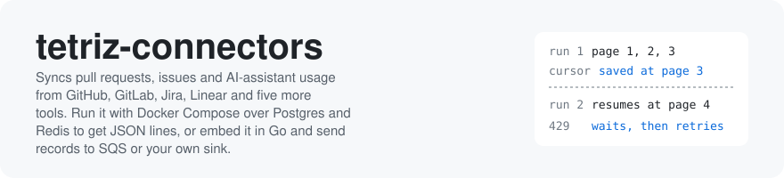
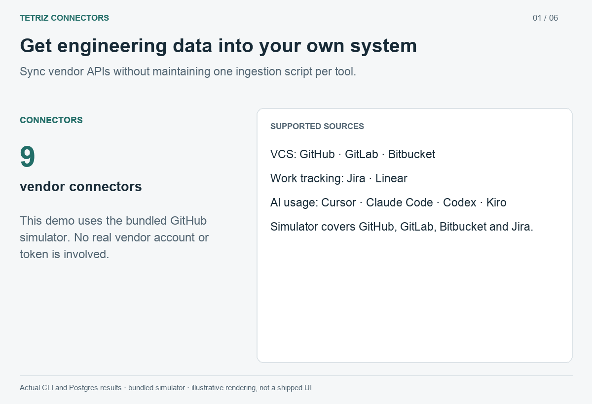
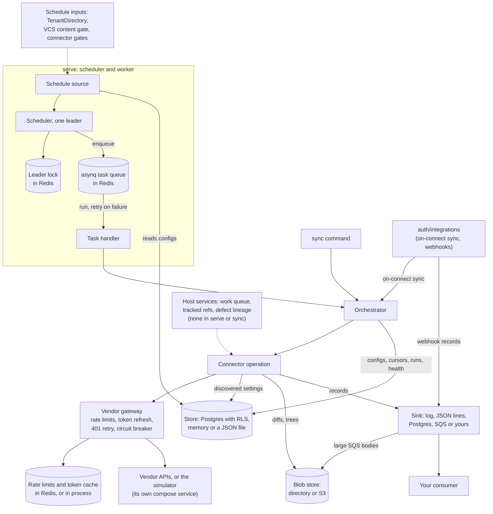
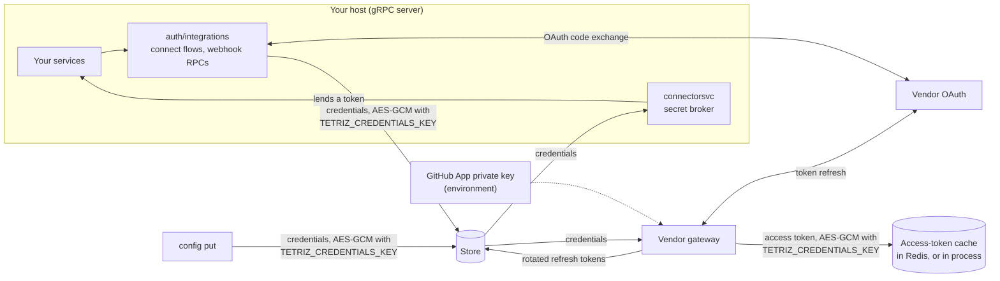

<picture>
  <source media="(prefers-color-scheme: dark)" srcset=".github/assets/banner-dark.svg">
  
</picture>

[](https://pkg.go.dev/github.com/tetriz-ai/tetriz-connectors)
[](LICENSE)


<a href="https://www.producthunt.com/products/tetriz-engg-intelligence-connectors?embed=true&amp;utm_source=badge-featured&amp;utm_medium=badge&amp;utm_campaign=badge-tetriz-engg-intelligence-connectors" target="_blank" rel="noopener noreferrer"></a>

Every vendor pages, rate-limits, expires tokens and fails in its own way, so getting pull requests, issues and assistant usage into your own database usually means one fragile script per tool that can stop, or re-read everything, after an outage. tetriz-connectors runs those syncs, resumes each one from its saved cursor, records why a run failed, and gives you the records as JSON lines, Postgres rows or SQS messages.



Sync → query your records → resume from saved progress. Simulator data. [Walkthrough](.github/assets/demo/README.md).

## Contents

- [What it does](#what-it-does) lists the pieces and what they are for.
- [Quick start](#quick-start) runs a GitHub sync against the bundled simulator in a few minutes, then against your own GitHub account.
- [Choosing an entry point](#choosing-an-entry-point) maps what you have to what to use.
- [Usage](#usage) shows each entry point in a complete example.
- [Reference](#reference) gives the exact rules for runs, cursors, errors, configuration and records, and the architecture.
- [Before you rely on it](#before-you-rely-on-it) lists the known limitations, each pinned by a test.
- [Project](#project) covers versioning, tests, contributing, security and the license.

## What it does

tetriz-connectors pulls records from vendor APIs on a schedule and hands them to a sink you choose. It needs Postgres and Redis, and the bundled simulator stands in for GitHub, GitLab, Bitbucket and Jira accounts.

- **`tetriz-connectors serve`**: keeps every connected organization's records current without a script per tool. It runs each operation on its schedule, resumes from the saved cursor after a failure or a restart, and records each run's outcome and error kind. [Quick start](#quick-start) runs it against the simulator, and [Send records to Postgres](#send-records-to-postgres) has the rows' rules.
- **The other commands**: run one sync now, store a config, show a cursor, migrate the store, list the connectors, print the record schemas and serve the vendor simulator.
- **Nine connectors**: GitHub, GitLab, Bitbucket, Jira, Linear, Cursor, Claude Code (package `connectors/anthropic`), Codex and Kiro. `tetriz-connectors connectors` prints each connector's id, such as `github` or `claude-code`.
- **`runner.Orchestrator`**: runs one operation for one organization, with the same cursor, sync-run and failure handling as `serve`. Your Go program then decides when a sync runs and which stores it uses.
- **`runner/schedule`**: schedules every enabled operation with asynq (a Redis-backed Go task queue) over a Redis-protocol store. One process leads and enqueues, and every process executes, so you can run several replicas.
- **`sdk`, `testkit` and `cli`**: the contract a connector implements, a conformance suite with a fake paginated vendor, and the whole command as a Go package, so you can add a vendor that has no connector and run it under `serve` and `sync`.
- **`auth/integrations` and `connectorsvc`**: gRPC services a host exposes for OAuth connect flows, webhooks, config queries and lending a connector's token. You can then let your product's users connect their own vendor accounts.
- **`schemas`**: a JSON Schema for every record payload, and a Go validator. [docs/records](docs/records/README.md) describes each connector's records, so you can check a payload before you trust it.
- **Helm chart**: [deploy/helm/tetriz-connectors](deploy/helm/tetriz-connectors/README.md) runs `serve` on Kubernetes.

GitHub, Cursor, Claude Code, Codex and Kiro take their credentials through `config put`. Jira, GitLab, Bitbucket and Linear take OAuth tokens that the connect flows in `auth/integrations` write, so they need a host serving those flows, as [Host the connect flows](#host-the-connect-flows) shows.

The store can be Postgres with row-level security, memory or a single JSON file. The sink can be the log, a JSON-lines file, a Postgres table or Amazon SQS. [Architecture and dependencies](#architecture-and-dependencies) shows how the pieces fit.

### What it does not do

- It does not turn records into metrics. Each record is the connector's own JSON, and some operations also keep the vendor's response body in `vendorBlobJson`.
- It does not listen for webhooks. A host exposes the webhook RPCs in `auth/integrations`, and they feed `webhook_events`.
- It does not ship a user interface for connecting accounts.
- It does not fetch diffs, file contents or defect lineage without an embedding host. [Operations and schedules](#operations-and-schedules) lists those operations and the host services they need.

## Quick start

You need Docker Compose v2, or another compose command as the block below shows. You need no vendor account and no Go toolchain.

```sh
git clone https://github.com/tetriz-ai/tetriz-connectors
cd tetriz-connectors
docker compose up --build --wait
```

That starts Postgres, Valkey (a Redis-compatible store), the vendor simulator and the runner. The compose runner sets `TETRIZ_ALLOW_PLAINTEXT_CREDENTIALS=1` and stores credentials unencrypted, which is for this demo only. Never set that variable in a real deployment.

Compose v1 and the Python podman-compose have no `--wait`. `podman compose` passes it to docker-compose when it uses that, and prints a provider notice on stderr that `PODMAN_COMPOSE_WARNING_LOGS=false` hides. Without `--wait`, start the stack with this block instead, which prints `ok` once the runner answers:

```sh
docker compose up -d --build
for i in $(seq 90); do
  curl -fsS localhost:${TETRIZ_RUNNER_PORT:-9090}/_health && break
  [ "$i" = 90 ] && echo "the runner is not healthy after 3 minutes: run docker compose logs runner"
  sleep 2
done
```

```text
ok
```

The stack publishes Postgres on 55432, Valkey on 56379 and the runner on 9090. If a port is taken, `TETRIZ_PG_PORT`, `TETRIZ_REDIS_PORT` or `TETRIZ_RUNNER_PORT` moves it.

Connect the demo organization's GitHub connector to the simulator. `deploy/gateway.demo.yaml` sends this organization ID to the simulator, which needs no credentials.

```sh
docker compose exec -T runner tetriz-connectors config put \
  --org 00000000-0000-4000-8000-00000000d3e0 --connector github \
  --settings '{"organization":"demo-gh-startup"}' --credentials '{}'
```

```text
stored github config for 00000000-0000-4000-8000-00000000d3e0 (enabled=true)
```

Sync its pull requests into Postgres, the `connector_records` table:

```sh
docker compose exec -T -e TETRIZ_SINK=postgres runner tetriz-connectors sync \
  --org 00000000-0000-4000-8000-00000000d3e0 --connector github --op fetch_prs 2>/dev/null \
  | grep -E '"(status|records_emitted)"'
```

It prints `"status": "completed"` and the record count. `2>/dev/null` hides the logs. Then count the merged pull requests in each repository:

```sh
docker compose exec -T postgres psql -U tetriz -d tetriz -c "
  SELECT metadata->>'repo' AS repo, count(*) AS merged
  FROM connector_records
  WHERE connector_id = 'github' AND operation_id = 'fetch_prs' AND metadata->>'event_type' = 'merged'
  GROUP BY 1 ORDER BY 1"
```

```text
            repo             | merged 
-----------------------------+--------
 demo-gh-startup/api-gateway |    238
 demo-gh-startup/mobile      |     94
 demo-gh-startup/web-app     |    440
(3 rows)
```

The counts depend on the day the simulator seeded its data. The runner also syncs the demo organization on its schedules, into `/data/records.jsonl` in the runner container.

When you are done, `docker compose down -v` removes everything.

### Use your own GitHub account

The same stack syncs a real GitHub organization with a personal access token. Make one with read access to the organization's repositories.

| Token | Access it needs |
|---|---|
| Fine-grained | Resource owner: the organization. Repository permissions: Contents, Metadata, Issues and Pull requests, read-only. Organization permissions: Projects, read-only. The organization may have to approve it |
| Classic | `repo`, or `public_repo` for public repositories only, plus `read:project` |

A token without organization administration or Copilot access still syncs repositories. `fetch_copilot_usage`, `fetch_org_members` and `fetch_projects` then fail as `config_invalid`, and the connector is not paused. Syncing only repositories and pull requests needs neither project permission.

`fetch_issues` needs `read:project` too, because the issue query asks each issue for the projects it sits on and GitHub rejects the whole query without that scope. A token without it syncs no issues: the run fails as a terminal `config_invalid` naming the scope, is not retried, and the connector is not paused:

```text
  "status": "failed",
  "error_kind": "config_invalid",
  "error": "fetching issues for repo … the token lacks a scope this query needs (needs read:project): … The 'title' field requires one of the following scopes: ['read:project'] …"
```

Store it under a new organization ID. Only the demo organization's ID goes to the simulator, so this one goes to the real GitHub API.

The compose runner stores the token unencrypted, and from now on syncs this organization on its schedules against your token's rate limit, until `config put --disabled` or `docker compose down -v`. `lookback_days` keeps the first pull-request sync to the last 30 days.

```sh
ORG=$(uuidgen | tr A-Z a-z)
GH_TOKEN=your-personal-access-token
GH_ORG=your-github-organization
docker compose exec -T runner tetriz-connectors config put --org "$ORG" --connector github \
  --settings "{\"organization\":\"$GH_ORG\",\"include_private\":true,\"lookback_days\":30}" \
  --credentials "{\"personal_access_token\":\"$GH_TOKEN\"}"
docker compose exec -T runner tetriz-connectors sync --org "$ORG" --connector github --op fetch_repos 2>/dev/null \
  | grep -E '"(status|records_emitted)"'
docker compose exec -T runner tetriz-connectors sync --org "$ORG" --connector github --op fetch_prs 2>/dev/null \
  | grep -E '"(status|records_emitted)"'
```

Each `sync` prints `"status": "completed"` and its record count. The records land in `/data/records.jsonl` in the runner container, beside the demo's. `fetch_repos` keeps only the repositories the organization owns, and `fetch_prs` reads the pull requests of the ones that are not archived.

## Choosing an entry point

| You have | Use | Example |
|---|---|---|
| Vendor accounts to sync on a schedule | The `tetriz-connectors` service | [Run the service](#run-the-service) |
| A Kubernetes cluster | The Helm chart | [Run on Kubernetes](#run-on-kubernetes) |
| A Go program that should run syncs itself | `runner.Orchestrator` | [Embed the orchestrator](#embed-the-orchestrator) |
| A vendor with no connector yet | `sdk`, `testkit` and `cli` | [Write a connector](#write-a-connector) |
| Records to send somewhere other than a file | A `sink.Publisher` | [Send records to a queue](#send-records-to-a-queue) |
| Records to query with SQL | `TETRIZ_SINK=postgres` or `sink/postgres` | [Send records to Postgres](#send-records-to-postgres) |
| A periodic job of your own for the scheduler | A `schedule.ScheduleSource` | [Add a job of your own](#add-a-job-of-your-own) |
| A product that connects vendor accounts for its users | `auth/integrations` and `connectorsvc` | [Host the connect flows](#host-the-connect-flows) |

The service, the orchestrator and the conformance suite all run the five steps in [What one run does](#what-one-run-does).

| To use it | Install |
|---|---|
| From Go | `go get github.com/tetriz-ai/tetriz-connectors` |
| As a command | `go install github.com/tetriz-ai/tetriz-connectors/cmd/tetriz-connectors@latest`, or a binary from Releases |
| As a container | `ghcr.io/tetriz-ai/tetriz-connectors` |

The macOS release binaries need macOS 13 or later. Release archives and the public container
are published manually after local validation; GitHub Actions stays disabled. Maintainers:
see [Releasing without Actions](docs/releasing.md).

## Usage

The Go examples need Go 1.26 or newer and run from the repository root.

### Run the service

When: you want every enabled connector synced on its schedule.

It needs the `tetriz-connectors` binary, Postgres and Redis. Install it with `go install ./cmd/tetriz-connectors` from the clone, or as [Choosing an entry point](#choosing-an-entry-point) shows. `go install` puts it in `$(go env GOPATH)/bin`, which must be on your PATH.

Start Postgres and Redis without the quick start's demo data:

```sh
docker compose down -v && docker compose up -d postgres redis
```

Without `down -v` the demo config stays enabled, and this `serve` syncs it against the real GitHub API with empty credentials. The quick start's runner would also hold port 9090 and share Redis with this `serve`.

Run once, to make the credentials key. Keep it stable, because credentials stored under one key do not decrypt under another.

```sh
(umask 077; openssl rand -base64 32 > ~/.tetriz-credentials-key)
```

Then point the runner at them and create its tables. If port 9090 is taken, also set `TETRIZ_HTTP_ADDR`.

```sh
export TETRIZ_POSTGRES_DSN="host=localhost port=${TETRIZ_PG_PORT:-55432} user=tetriz password=tetriz-local-only dbname=tetriz sslmode=disable"
export TETRIZ_REDIS_ADDR=localhost:${TETRIZ_REDIS_PORT:-56379}
export TETRIZ_CREDENTIALS_KEY="$(cat ~/.tetriz-credentials-key)"
tetriz-connectors migrate
```

The compose `tetriz` user is a superuser, which skips row-level security. Outside a demo, connect as the tables' owner, as [Configuration](#configuration) explains.

`migrate` prints how many migrations it applied:

```text
applied 1 migration
```

Before starting `serve`, try it on the simulator with no vendor account. Keep `TETRIZ_GATEWAY_CONFIG` exported in every terminal that runs `serve` afterwards, or `serve` syncs the demo organization against the real GitHub API with empty credentials.

```sh
TETRIZ_SIMULATOR_DSN="$TETRIZ_POSTGRES_DSN" tetriz-connectors simulator --seed --addr 127.0.0.1:8080 >"${TMPDIR:-/tmp}/tetriz-simulator.log" 2>&1 &
sed 's#http://simulator:8080#http://localhost:8080#' deploy/gateway.demo.yaml >"${TMPDIR:-/tmp}/tetriz-gateway.yaml"
export TETRIZ_GATEWAY_CONFIG="${TMPDIR:-/tmp}/tetriz-gateway.yaml"
for i in $(seq 60); do curl -fsS localhost:8080/_health >/dev/null 2>&1 && break; sleep 1; done
tetriz-connectors config put --org 00000000-0000-4000-8000-00000000d3e0 --connector github \
  --settings '{"organization":"demo-gh-startup"}' --credentials '{}'
tetriz-connectors sync --org 00000000-0000-4000-8000-00000000d3e0 --connector github --op fetch_repos 2>/dev/null \
  | grep -E '"(status|records_emitted)"'
```

```text
stored github config for 00000000-0000-4000-8000-00000000d3e0 (enabled=true)
  "status": "completed",
  "records_emitted": 3
```

The simulator is unauthenticated, so it listens on 127.0.0.1 unless `--addr` says otherwise.

Then start the runner:

```sh
tetriz-connectors serve
```

Once `serve` is up, `curl localhost:9090/_health` (or the port you set in `TETRIZ_HTTP_ADDR`) prints `ok`.

`serve` holds the terminal. Open a second terminal, repeat the port variables (if you moved them) and the exports, and store each organization's config with `config put`. [Connector credentials and settings](#connector-credentials-and-settings) lists what `--credentials` and `--settings` take for each connector.

For GitHub, the settings decide which repositories sync.

- A personal access token without `organization` in the settings syncs every repository the token reaches in `fetch_repos`.
- The operations that loop over repositories, such as `fetch_prs`, need `organization` or a `repositories` list.
- Without `"include_private":true` in the settings, only public repositories sync.
- A GitHub App install (`installation_id`) also needs `organization`.

Store each organization's config and check it with one `sync`, as [Use your own GitHub account](#use-your-own-github-account) shows, without the `docker compose exec -T runner` prefix. `ORG` is any UUID you choose, and the first put creates it.

`serve` picks up a new config when it next rebuilds its schedules, within three minutes. It then runs each operation at the operation's next scheduled time.

Records go to the log by default. [Configuration](#configuration) lists the other `TETRIZ_SINK` values.

Remember:

- A later `config put` without `--credentials` keeps the stored credentials, and one without `--settings` keeps the stored settings. A first put needs `--credentials`.
- A `config put` without `--disabled` enables the connector, including one a webhook or an operator disabled (`TestLimitation_ConfigPutWithoutDisabledEnables`).

### Run on Kubernetes

When: you run `serve` in a Kubernetes cluster.

The chart in [deploy/helm/tetriz-connectors](deploy/helm/tetriz-connectors/README.md) runs `serve` and bundles no stores. Point it at your own Postgres and Redis, and keep the secrets in a Secret whose keys are the variable names:

```sh
kubectl create secret generic tetriz-secrets \
  --from-literal=TETRIZ_POSTGRES_DSN="host=pg.example port=5432 user=tetriz password=... dbname=tetriz sslmode=require" \
  --from-literal=TETRIZ_CREDENTIALS_KEY="$(openssl rand -base64 32)"
helm install tetriz deploy/helm/tetriz-connectors \
  --set config.redisAddr=valkey.example:6379 \
  --set secrets.existingSecret=tetriz-secrets
```

The install notes print the commands that store a config and run one sync in a runner pod. `-f deploy/helm/tetriz-connectors/values-demo.yaml` instead runs the simulator beside the runner, for a demo with no vendor account.

Remember:

- Several replicas are safe. One holds the leader lock and enqueues, and every replica runs tasks. `serve` applies the migrations at start under a Postgres advisory lock.
- A Redis that needs a password or TLS takes `secrets.redisUrl` or `secrets.redisPassword`. `config.namespace` lets several releases share one Redis.
- Make the DSN's user the tables' owner, not a superuser or a `BYPASSRLS` role, or row-level security does not apply.

### Embed the orchestrator

When: your program decides when a sync runs, or supplies its own stores.

This is [testkit/fakevendor/example_test.go](testkit/fakevendor/example_test.go), which `go test` runs as a test.

```go
package fakevendor_test

import (
	"context"
	"encoding/json"
	"fmt"
	"time"

	"github.com/tetriz-ai/tetriz-connectors/runner"
	"github.com/tetriz-ai/tetriz-connectors/runner/store/memstore"
	"github.com/tetriz-ai/tetriz-connectors/sdk"
	"github.com/tetriz-ai/tetriz-connectors/sink"
	"github.com/tetriz-ai/tetriz-connectors/testkit/fakevendor"
)

// Run one polling sync end to end: a connector, a vendor, an in-memory store
// and a sink, with the orchestrator in between.
func Example() {
	ctx := context.Background()
	vendor := fakevendor.New(
		fakevendor.Item{ID: "a", Title: "first", UpdatedAt: time.Date(2026, 1, 1, 0, 0, 0, 0, time.UTC)},
		fakevendor.Item{ID: "b", Title: "second", UpdatedAt: time.Date(2026, 1, 2, 0, 0, 0, 0, time.UTC)},
	)
	defer vendor.Close()

	store := memstore.New()
	settings, _ := json.Marshal(fakevendor.Settings{BaseURL: vendor.URL})
	_ = store.Save(ctx, &sdk.ConnectorConfig{
		OrganizationID: "00000000-0000-4000-8000-000000000001", ConnectorID: fakevendor.ConnectorID,
		Settings: settings, Credentials: json.RawMessage(`{"token":"example"}`), Enabled: true,
	})

	registry := sdk.NewConnectorRegistry()
	registry.Register(fakevendor.Connector{})
	records := sink.NewChannelSink()
	orch := runner.NewOrchestrator(registry, store, store, store, records, fakevendor.GatewayFactory(nil))

	err := orch.RunOperation(ctx, "00000000-0000-4000-8000-000000000001", fakevendor.ConnectorID, fakevendor.OpFetchItems, sdk.TenantKindOrganization, "example")
	fmt.Println("error:", err)
	for _, r := range records.Records() {
		fmt.Println(r.ExternalID)
	}
	// Output:
	// error: <nil>
	// a
	// b
}
```

The built-in connectors run the same way without Redis. `app.NewGatewayFactory(app.InProcessGatewayDeps(app.Config{}, inprocess.New()))` builds their gateways on in-process stores from `gateway/ratelimiter/inprocess`. [examples/embedgithub](examples/embedgithub/main.go) syncs a token's GitHub repositories this way:

```sh
GITHUB_TOKEN=your-personal-access-token go run ./examples/embedgithub
```

It prints the full name of each repository, one per line. The in-process stores hold rate limits, budgets and cached tokens per process, so two processes on one vendor account each spend the full budget.

`orch.WithHostServices(h)` runs the operations that need host services, which [Operations and schedules](#operations-and-schedules) lists. `orch.WithLogger(l)` sends a run's log entries to your `slog.Logger` instead of `slog.Default()`.

Remember:

- The in-memory store keeps nothing across restarts. Use `memstore.OpenFile` or the Postgres store in `runner/store` to keep state.
- With Postgres, pass `store.PostgresTxRunner{}` to `WithTxRunner` so every query runs inside the organization's row-level-security scope.
- The Bitbucket and GitLab gateways each keep a circuit breaker that opens after repeated 429s (ADR-0004 §5). On in-process stores it trips per process.

### Write a connector

When: you need a vendor that is not in the box.

A connector declares its ID, display name, categories and `OperationDescriptor`s, and each operation implements `APIFetchOperation`.

[testkit/fakevendor/connector.go](testkit/fakevendor/connector.go) is a complete connector. Check yours with the conformance suite, the way [testkit/fakevendor/readme_conformance_test.go](testkit/fakevendor/readme_conformance_test.go) checks that one.

The suite checks the connector's declarations and runs the operation twice. An operation whose `RequiresHost` names a host service must be refused when run without it. Five optional fields add checks:

| Field | Fails when |
|---|---|
| `Resume` | the second run does not resume from the stored cursor |
| `WantExternalIDs` | a listed id is never emitted over the two runs |
| `AddBetweenRuns` | a record added after the first run does not reach the second |
| `Faults` | a vendor 401, 403, 429, 500, 503 or an answer past the run's deadline does not fail the run with the right error kind |
| `Checkpoints` | with `Faults`, a run that fails after its first checkpoint is not resumed from it |

`Faults` takes the vendor the gateway talks to. A `*fakevendor.Server` is one, and `testkit.FaultHandler` wraps any `http.Handler` as one.

```go
package fakevendor_test

import (
	"encoding/json"
	"testing"
	"time"

	"github.com/tetriz-ai/tetriz-connectors/sdk"
	"github.com/tetriz-ai/tetriz-connectors/testkit"
	"github.com/tetriz-ai/tetriz-connectors/testkit/fakevendor"
)

// TestConnectorConforms is the conformance check the README shows: the
// fake vendor's connector against the suite, with the vendor it talks to.
func TestConnectorConforms(t *testing.T) {
	items := []fakevendor.Item{
		{ID: "a", Title: "first", UpdatedAt: time.Date(2026, 1, 1, 0, 0, 0, 0, time.UTC)},
		{ID: "b", Title: "second", UpdatedAt: time.Date(2026, 1, 2, 0, 0, 0, 0, time.UTC)},
	}
	vendor := fakevendor.New(items...)
	defer vendor.Close()
	// One item a page, so the listing checkpoints between pages.
	settings, _ := json.Marshal(fakevendor.Settings{BaseURL: vendor.URL, PageSize: 1})
	testkit.RunConformance(t, fakevendor.Connector{}, testkit.ConformanceRun{
		Operation: fakevendor.OpFetchItems,
		Config:    sdk.ConnectorConfig{Settings: settings},
		Gateway:   fakevendor.GatewayFactory(nil),
		// The second run's first request must resume from the stored cursor.
		Resume: func(stored *sdk.Cursor, first testkit.VendorCall) error {
			return fakevendor.ResumesFrom(stored, first.Request)
		},
		WantExternalIDs: []string{"a", "b"},
		// A record added after the first run must reach the second.
		AddBetweenRuns: func() []string {
			vendor.SetItems(append(items, fakevendor.Item{ID: "c", Title: "third", UpdatedAt: time.Date(2026, 1, 3, 0, 0, 0, 0, time.UTC)})...)
			return []string{"c"}
		},
		// The vendor fails on demand: each failure must fail the run with
		// the right error kind, and a run that fails after a checkpoint
		// must be resumed from it.
		Faults:      vendor,
		Checkpoints: true,
	})
}
```

To run your connector under `serve` and `sync`, build your own binary on the `cli` package. `cli.Main(ctx, args, stdout, stderr, opts...)` is the whole `tetriz-connectors` command, and `app.WithConnector(conn, gatewayBuilder)` adds a connector with the gateway its runs get. [examples/customconnector](examples/customconnector/main.go) adds a `todo` connector this way:

```sh
go run ./examples/customconnector connectors | grep -A1 '^todo'
```

```text
todo
  fetch_todos                  */15 * * * *
```

Its `serve` schedules `fetch_todos` beside the built-in operations, and `sync`, `config put` and `cursor show` accept `--connector todo`. An id that a built-in connector already uses is an error. `app.WithHostServices`, `app.WithPublisher`, `app.WithTenantDirectory` and `app.WithGatewayWrapper` change the rest of what `serve` wires.

Remember:

- Return an `*sdk.SyncError` with a `Kind` for every failure, and set `Terminal` when retrying cannot help. A terminal `auth` error pauses the connector, as [What one run does](#what-one-run-does) explains.
- Call `params.Checkpoint` after each page when a run can outlast its deadline. The cursor you return is saved only when the run succeeds.

### Send records to a queue

When: records should go to a queue or a stream rather than a file.

`sink.NewConnectorSink(p)` turns any `sink.Publisher` into the `sdk.DataSink` that `runner.NewOrchestrator` takes. `sink/sqs` is a Publisher for Amazon SQS that moves bodies over 225 KiB to a `sdk.BlobStore` and sends the key. This is [sink/sqs/example_test.go](sink/sqs/example_test.go):

```go
package sqs_test

import (
	"context"
	"fmt"

	"github.com/aws/aws-sdk-go-v2/aws"
	awssqs "github.com/aws/aws-sdk-go-v2/service/sqs"

	"github.com/tetriz-ai/tetriz-connectors/blobstore"
	connectorpb "github.com/tetriz-ai/tetriz-connectors/gen/connector/v1"
	"github.com/tetriz-ai/tetriz-connectors/sink/sqs"
)

// printingQueue stands in for *sqs.Client: it prints each message.
type printingQueue struct{}

func (printingQueue) SendMessage(_ context.Context, in *awssqs.SendMessageInput, _ ...func(*awssqs.Options)) (*awssqs.SendMessageOutput, error) {
	fmt.Println(aws.ToString(in.MessageBody))
	return &awssqs.SendMessageOutput{MessageId: aws.String("1")}, nil
}

// Publish envelopes to a queue. With a real queue, pass an *sqs.Client from
// the AWS SDK.
func ExampleNew() {
	publisher := sqs.New(printingQueue{}, "https://sqs.example.com/queue", &blobstore.Memory{}, "offload")
	_, _ = publisher.Publish(context.Background(), &connectorpb.ConnectorDataEnvelope{OrganizationId: "org-1"})
	// Output: {"organizationId":"org-1"}
}
```

Remember:

- A Publisher receives a `ConnectorDataEnvelope` protobuf. Its field numbers are stable, so consumers can decode it with the schema in `proto/`.
- Delivery is at least once, and incremental runs re-send the records at their cursor boundary. Deduplicate on the envelope's key, as [docs/records](docs/records/README.md) explains.

### Send records to Postgres

When: you want to query records with SQL.

`TETRIZ_SINK=postgres` writes each record to the `connector_records` table, in `TETRIZ_SINK_POSTGRES_DSN` or else the store's own database. The command creates the table when it starts, and [Quick start](#quick-start) queries it.

`payload` is the record's JSON as `jsonb`, so `payload->>'title'` reads a field. [docs/records](docs/records/README.md) lists each operation's fields and metadata keys.

A row's key is the organization, connector, operation, external id and data date, and records with no data date share one key value for it. A record that arrives again changes its row by these rules:

| The new copy | The row |
|---|---|
| Has a later `fetched_at` | Takes the new copy. `updated_at` moves only when the payload or metadata changed |
| Has an earlier `fetched_at` | Stays as it is |
| Has the same `fetched_at` | Takes the new copy only when its content differs |

`first_seen_at` keeps the time of the first insert. A payload that is not JSON is stored as a base64 JSON string, with `payload_encoding` set to `base64`.

In Go, `postgres.Open(ctx, dsn)` from `sink/postgres` migrates the table and returns a `sink.Publisher`, as [sink/postgres/example_test.go](sink/postgres/example_test.go) shows. `postgres.New(db)` takes your own `*sql.DB`, after `postgres.Migrate`.

Remember:

- The table has no row-level security. Every organization's records are in it, so grant access to it as you would to the whole sink.
- An incremental run sends the last records it read again, because vendor `since` filters are inclusive. Those copies land on their existing rows, so a re-sync adds no rows.

### Add a job of your own

When: you want the scheduler to run a periodic job that is not a connector sync.

A `schedule.ScheduleSource` returns the jobs to register, and an `asynq.Handler` runs each one. [examples/heartbeat](examples/heartbeat) is a complete source and handler. This is [examples/heartbeat/example_test.go](examples/heartbeat/example_test.go):

```go
package heartbeat_test

import (
	"context"
	"fmt"

	"github.com/tetriz-ai/tetriz-connectors/examples/heartbeat"
)

// A ScheduleSource returns the jobs the scheduler registers. This one
// returns one job that fires every ten seconds.
func ExampleSource() {
	defs, err := heartbeat.NewSource("@every 10s").FetchSchedules(context.Background())
	if err != nil {
		panic(err)
	}
	for _, d := range defs {
		fmt.Println(d.ID, d.JobType, d.CronExpression, d.Queue)
	}
	// Output: heartbeat/ping example.heartbeat @every 10s default
}
```

Run it against a Valkey that no runner uses, such as the quick start's with the runner stopped:

```sh
docker compose stop runner && docker compose up -d redis && REDIS_ADDR=localhost:${TETRIZ_REDIS_PORT:-56379} go run ./examples/heartbeat/cmd
```

The handler logs a line like this soon after start, then about every ten seconds, between the scheduler's own log lines:

```console
2026/01/02 10:00:00 INFO heartbeat message=ping fired_at=2026-01-02T10:00:00.000Z
```

Remember:

- The example runs a bare asynq `PeriodicTaskManager`, so every copy of it enqueues. In a service, pass your source to `schedule.NewScheduler` beside `App.ScheduleSource()`, so only the leader enqueues.
- A `serve` on the same Redis drains the same default queue, so it takes the example's tasks and fails them, as it has no handler for them.

### Host the connect flows

When: your product connects vendor accounts for its users.

| Constructor | Serves |
|---|---|
| `integrations.NewService` | OAuth and token connect flows, disconnect, the integration catalog and the webhook RPCs |
| `connectorsvc.NewService` | Config and repository queries, and the secret broker that lends a connector's token to the callers its `SecretAuthorizer` allows, none without one |

Register both on your own gRPC server, behind your own authentication. The example's `slack_comms` grant is retained for outbound notifications; it is separate from the nine data-sync connectors.

From [auth/integrations/example_host_test.go](auth/integrations/example_host_test.go):

```go
package integrations_test

import (
	"fmt"
	"sort"

	"google.golang.org/grpc"

	"github.com/tetriz-ai/tetriz-connectors/auth/integrations"
	"github.com/tetriz-ai/tetriz-connectors/connectors/config"
	"github.com/tetriz-ai/tetriz-connectors/connectorsvc"
	connectorpb "github.com/tetriz-ai/tetriz-connectors/gen/connector/v1"
	integrationsv1 "github.com/tetriz-ai/tetriz-connectors/gen/integrations/v1"
	"github.com/tetriz-ai/tetriz-connectors/runner/app"
	"github.com/tetriz-ai/tetriz-connectors/runner/store"
	"github.com/tetriz-ai/tetriz-connectors/runner/store/memstore"
	"github.com/tetriz-ai/tetriz-connectors/sink"
)

// Register the connect flows and the connector queries on your own gRPC
// server. A real host passes the Postgres stores, Redis and the vendor OAuth
// clients, and puts its own authentication in front of the server.
// store.PostgresTxRunner scopes every store call to the organization. On the
// memory store it does nothing.
func Example_hostTheConnectFlows() {
	stores := memstore.New()
	registry := app.NewRegistry(nil)
	srv := grpc.NewServer()
	integrationsv1.RegisterIntegrationServiceServer(srv, integrations.NewService(integrations.Deps{
		Tx:           store.PostgresTxRunner{},
		Cfg:          &config.Config{},
		ConnectorDAO: stores,
		SyncStateDAO: stores,
		SyncRunDAO:   stores,
		Registry:     registry,
	}))
	// GetSecret lends only what the authorizer allows, and nothing without one.
	connectorpb.RegisterConnectorServiceServer(srv, connectorsvc.NewService(store.PostgresTxRunner{}, stores, stores, stores, registry, sink.NewChannelSink(), nil, nil,
		connectorsvc.WithSecretAuthorizer(connectorsvc.AllowConnectors("slack_comms"))))

	var names []string
	for name := range srv.GetServiceInfo() {
		names = append(names, name)
	}
	sort.Strings(names)
	for _, name := range names {
		fmt.Println(name)
	}
	// Output:
	// tetriz.connectors.connector.v1.ConnectorService
	// tetriz.connectors.integrations.v1.IntegrationService
}
```

Remember:

- The RPCs are defined in `proto/tetriz/connectors/integrations/v1` and `proto/tetriz/connectors/connector/v1`.
- A GitHub App installation, a Kiro bucket, an Anthropic organization and a Codex workspace each belong to one organization. A second organization's connect is refused with `AlreadyExists`, because the runner reaches them with access it holds rather than a credential the organization brings.

The full Go API is on [pkg.go.dev](https://pkg.go.dev/github.com/tetriz-ai/tetriz-connectors), and [Commands](#commands) covers the command. Each example's full program is in [examples](examples/README.md).

## Reference

### Commands

`tetriz-connectors help` lists the commands, and `tetriz-connectors <command> --help` shows one command's flags. Flags take one or two dashes.

| Command | Does | Exits non-zero when |
|---|---|---|
| `serve` | Runs the scheduler and the worker, with `/_health` and `/metrics` | It cannot start, or it stops on an error |
| `sync` | Runs one operation for one organization now and prints the run as JSON. The run gets the deadline `serve` would give it: the operation's timeout, or 10 minutes | The run fails |
| `config put` | Stores an organization's connector config | The write fails |
| `cursor show` | Prints the stored cursor of one operation | The read fails |
| `migrate` | Applies the store's migrations | The database is unreachable or a migration fails |
| `simulator` | Serves the vendor simulator | It cannot start, or it stops on an error |
| `connectors` | Lists the connectors, their operations and default schedules, and the host services an operation needs | Only on a usage error |
| `schema` | Lists the operations that have a record schema, or prints one operation's JSON Schema | Only on a usage error, including an operation with no schema |
| `version` | Prints the version | Only on a usage error |

| Exit code | When |
|---|---|
| 0 | The command succeeded, or `help` or `--help` printed the usage to stdout |
| 1 | The command failed, such as a `sync` whose run failed |
| 2 | A usage error: a missing or unknown flag, an unknown command, an `--org` that is not a UUID, or an unknown connector or operation. With no command at all, the usage goes to stderr |

### What one run does

`Orchestrator.RunOperation` does these steps in order. A step that fails ends the run.

| Step | What happens | On failure |
|---|---|---|
| Load | Reads the config and skips a disabled connector, or one paused as `auth_revoked` after a terminal auth error | Run not started |
| Start | Closes the operation's runs whose lease expired as `abandoned`, then writes a sync-run row with status `running` and a two-minute lease | Run not started |
| Check | Checks the host services, then calls the connector's `ValidateConfig`, except for a simulated organization | Row `failed`, terminal `config_invalid` |
| Execute | Calls the operation with the stored cursor, renewing the lease every 40 seconds. A run whose row was closed, or that renews nothing for a whole lease, stops as `abandoned` and writes nothing more | Row `failed` with an error kind, cursor unchanged |
| Finish | Flushes the sink, saves the returned cursor and marks the row `completed` | Row `failed` |

- **Cursor.** The runner stores any non-nil cursor an operation returns, and a nil cursor keeps the previous one. An empty cursor (`&sdk.Cursor{}`) resets it, so the next run starts as a first run (`TestEmptyCursorResets`).
- **Cursor conflicts.** A save succeeds only over the cursor version the run read. When another run saved first, the run fails with a retryable `store.ErrCursorConflict` and the newer cursor stays (`TestCursorConflictKeepsTheNewerCursor`).
- **Records.** A record that names another organization than the run's fails the run as `internal`, and the sink never sees it (`TestRecordFromAnotherOrgFailsTheRun`). The sink refuses a record with no `ExternalID`. `records_emitted` counts each record the sink took, also in a batch that failed part way.
- **Checkpoints.** `params.Checkpoint` flushes the sink, then saves a cursor mid-run. A failed run keeps its last checkpoint.
- **Repositories.** Some operations loop over repositories: GitHub `fetch_prs` and `fetch_issues_data`, and `fetch_branches`, `fetch_repo_tree` and `fetch_prs_data` on GitHub, GitLab and Bitbucket. Jira's operations loop over projects and Linear's over teams.
- **A failing repository.** It is skipped and keeps its cursor while the others sync. When every attempted repository fails, the run fails, and it pauses only when every failure was a 401 or 403.
- **Config.** A config the connector's `ValidateConfig` rejects fails the run before it executes, terminal and `config_invalid` (`TestRejectedConfigFailsTheRunBeforeExecute`).
- **Host services.** An operation whose `RequiresHost` names a service the orchestrator was not given fails before it executes. The error is terminal and `config_invalid`, and it names the missing services (`TestOrchestrator_RefusesAnOperationMissingHostServices`).
- **Pause.** A run that fails with a `Terminal` `auth` error marks the connector `auth_revoked`. It stays paused until its credentials are written again, by `config put` with `--credentials` or by a connect flow in `auth/integrations`.
- **Panics.** A panic in an operation, in `params.Checkpoint`, in `ValidateConfig` or in an operation or gateway factory fails the run with kind `internal` and the panic value, and so does a nil cursor passed to `params.Checkpoint`. The stack goes to the log. A panic in a goroutine the operation starts itself still crashes the process, as Go cannot recover it.

| Vendor answer | Result |
|---|---|
| A 401 | Pauses the connector |
| A 403 on a repository listing, or on the user or installation endpoint | Pauses the connector |
| A 403 on an organization-scoped endpoint a token may lack (GitHub Copilot usage, organization members, projects) | Fails that operation as `config_invalid` without pausing the connector |
| A missing token scope from GitHub (GraphQL `INSUFFICIENT_SCOPES`, or a 403 whose scope headers show none of the accepted scopes) | Fails that operation as a terminal `config_invalid` naming the scope, without retrying or pausing |
| A 401 or 403 from every repository or project, with none left unread, other than a missing scope | Pauses the connector |
| A 403 from one repository or project | Skips it without pausing, also when the others fail for another reason |

### Error kinds

Every failure is recorded on the sync-run row as one of these kinds.

| Kind | Meaning |
|---|---|
| `auth` | Credentials rejected |
| `rate_limit` | A vendor or local rate limit was hit |
| `not_found` | The resource is gone (404 or 410) |
| `timeout` | A connector reports a vendor call that timed out |
| `ctx_exhausted` | The run's context ended and the error is a context error |
| `abandoned` | The run's lease expired: the process running it stopped without closing it |
| `vendor_error` | The vendor returned a 5xx, or a 4xx other than 401, 403, 404, 410 and 429, with its status kept |
| `config_invalid` | The connector's `ValidateConfig` rejects the config, its settings are unusable, the operation needs host services the runner does not have, or the token lacks access to an organization-scoped endpoint. It is terminal for that fire only: it does not pause the connector or stop the schedule, which fires again at its next time |
| `invalid_input` | A caller's arguments failed validation |
| `sink_failure` | The sink rejected a record or a flush |
| `internal` | Anything else, including a plain error from connector code or a panic in it |

- **Enrichment.** A failed enrichment inside a run, such as GitHub team memberships, logs a WARN and does not fail the run (`TestFailedTeamEnrichmentDoesNotFailFetchOrgMembers`).
- **Deadlines.** When the run's context has ended and the returned error is a context error, the run records `ctx_exhausted`. Any other error keeps its own kind, even after the deadline. When a deadline the connector set for itself passes, the run records the connector's own error kind, or `internal` for a plain error.
- **What an error carries.** A vendor HTTP error records its status, the vendor's request id when a header names one, and only the vendor's error code and message fields of a JSON body, each cut to 200 bytes. A body that is not JSON contributes only its length and content type. Request URLs in logs and errors carry no query string or fragment.
- **Response size.** A vendor response body over 32 MiB fails its request as a terminal `vendor_error` on the shared gateway paths. Diffs, file contents, blame and branch pages keep their own caps.
- **Retries.** The scheduler retries a failed task up to its retry count, default 3, unless the error is an `*sdk.SyncError` with `Terminal` set. [Before you rely on it](#scheduling) says why a definition cannot turn retries off.
- **Retry delay.** When the vendor's Retry-After is longer than the jittered exponential backoff, the retry waits the Retry-After plus jitter, capped at one hour. Otherwise it waits the backoff.
- **Undecodable tasks.** A task whose payload does not decode fails once, without retries.

### Operations and schedules

`serve` treats each operation in one of five ways. `tetriz-connectors connectors` marks each operation that needs host services with `(needs host: …)`.

| Operations | What serve does |
|---|---|
| Most, such as `fetch_prs`, `fetch_issues` and `fetch_users` | Runs each on its default schedule and emits records. |
| `fetch_pr_diffs`, `fetch_mr_diffs`, `drain_defect_lineage`, `drain_defect_scoring` | Schedules each only when the host services it needs are provided, which the stock command never does. A `sync` of one fails and exits 1 with a terminal `config_invalid` error that names the missing services. A binary built on `cli.Main` with `app.WithHostServices` runs them. |
| `fetch_file_content` | Needs the work queue, like the diff operations, and also a content gate that an embedding host opens for an organization. `serve` never schedules it, and a `sync` of it fails like the diff operations. |
| `fetch_config`, `fetch_projects` (GitHub), `fetch_comments` (Jira) | Never schedules them. Run one with `sync`. |
| `webhook_events` | Never schedules it. The webhook RPCs feed it. |

### Configuration

- **Environment.** The runner reads only `TETRIZ_*` variables. [.env.example](.env.example) lists each one with its default.
- **Redis.** `TETRIZ_REDIS_ADDR` is a `host:port`, with `TETRIZ_REDIS_PASSWORD` when it needs one. `TETRIZ_REDIS_URL` takes a `redis://` or `rediss://` (TLS) URL with an optional user, password and database, and wins over both.
- **Namespace.** `TETRIZ_NAMESPACE` prefixes the asynq queues, the leader lock and every other Redis key the runner writes with `<namespace>:`, so several deployments can share one Redis. asynq's own registry of servers and workers stays shared. Empty, the default, keeps the unprefixed names.
- **Sink.** `TETRIZ_SINK` is `log` (the default), `-` for JSON lines on stdout, `postgres` for the `connector_records` table, or a file path. `TETRIZ_SINK_POSTGRES_DSN` names the sink's database, and empty means `TETRIZ_POSTGRES_DSN`.
- **Vendor endpoints and rates.** `gateway/defaults.yaml` holds each vendor's base URLs and one rate per rate-limit group. `TETRIZ_GATEWAY_CONFIG` replaces the file. An unknown key or a rate of zero or below is an error.
- **Simulator routing.** `SimulatorOrgIDs` and `SimulatorBaseURL` in the gateway file send listed organizations to the simulator. See [internal/simulator/README.md](internal/simulator/README.md).
- **Schedule overrides.** An entry in a config's operation overrides, such as `{"schedule":"0 * * * *"}`, replaces that operation's default schedule. An entry that does not parse, or whose schedule is not a cron expression, is logged, and the operation keeps its default schedule. A disabled schedule override pauses its operation.
- **A failing source.** A schedule source or connector whose read fails keeps its last good schedules until a read succeeds.
- **Tenant kinds.** Scheduled runs stamp each organization with a tenant kind, `organization` by default. The kind picks endpoints, such as GitHub's repository listing for an App install. `TETRIZ_DEFAULT_TENANT_KIND` and `TETRIZ_TENANT_KINDS_FILE` override it.
- **Tenant kinds in Go.** A binary built on `cli.Main` passes `app.WithTenantDirectory`, and an embedding host sets `App.Tenants`.
- **Database role.** Every store table forces row-level security, and the runner and the gRPC services scope every store call. Connect as the tables' owner, because a superuser or a `BYPASSRLS` role skips row-level security. The compose stack's superuser is for the demo only.
- **Health and metrics.** `serve` exposes `/_health` and `/metrics` on `TETRIZ_HTTP_ADDR` (default `:9090`). Metric names carry `TETRIZ_METRICS_PREFIX` (default `tetriz_`).
- **Metrics in Go.** Importing the module registers no metrics. An embedding host calls `app.RegisterMetrics(reg, prefix)` with its own registry.
- **Logs in Go.** `app.WithLogger` and `Orchestrator.WithLogger` send the entries a run logs to your `slog.Logger`. Without them, they go to `slog.Default()`.

### Connector credentials and settings

| Connector | `config put --credentials` | `config put --settings` |
|---|---|---|
| GitHub | `personal_access_token`, or `installation_id` for a GitHub App install with `TETRIZ_GITHUB_APP_ID` and `TETRIZ_GITHUB_APP_PRIVATE_KEY` set | `organization`, `repositories`, `include_private`, `lookback_days`, `tracked_branch`, `track_all_branches` |
| Cursor | `api_key` | `lookback_days`, `trailing_overlap_days` |
| Claude Code | `api_key` | `anthropic_organization_id` (the organization), `lookback_days` |
| Codex | `api_key` | `workspace_id` (the workspace), `lookback_days` |
| Kiro | `role_arn` and `external_id` | `bucket`, `prefix`, `region`, `account_id` |
| Jira, GitLab, Bitbucket, Linear | OAuth tokens from a connect flow | Written by the connect flow |

The runner refreshes OAuth tokens when `TETRIZ_<VENDOR>_OAUTH_CLIENT_ID` and `_CLIENT_SECRET` are set (see [.env.example](.env.example)). The connect flows in `auth/integrations` write settings such as Jira's `cloud_id` and `project_keys`, GitLab's `group_id`, and Bitbucket's `workspace`. Each connector's `config.go` defines its full set of settings.

Bitbucket takes OAuth tokens only, with no app password. A config that carries `app_password` or `username` fails its first run as `config_invalid`, because the runner authenticates Bitbucket through OAuth.

### Records

[docs/records](docs/records/README.md) says how to read an envelope and deduplicate records, and has one page per connector with each operation's external id, data date, payload fields and metadata keys.

Every operation that emits records has a JSON Schema at `schemas/<connector>/<operation>.schema.json`. `tetriz-connectors schema` lists them, and prints one:

```sh
tetriz-connectors schema github fetch_prs | head -4
```

```text
{
  "$schema": "https://json-schema.org/draft/2020-12/schema",
  "$id": "https://github.com/tetriz-ai/tetriz-connectors/schemas/github/fetch_prs.schema.json",
  "title": "github fetch_prs",
```

- **Validating.** In Go, `schemas.Validate(connectorID, operationID, payload)` checks a decoded payload against its schema. `schemas.Schema` returns one schema, and `schemas.List` names them all.
- **Kept in step.** A test fails when a record-emitting operation has no schema (`TestEveryRecordOperationHasASchema`). Another runs the GitHub, GitLab, Bitbucket and Jira connectors against the simulator and validates every record they emit (`TestSimulatedPayloadsMatchSchemas`).

### Architecture and dependencies

The run path, from a schedule, a `sync` or a connect flow to the sink:



The credentials path, from a connect flow or `config put` to the runner and back:



| Dependency | Needed for | Required |
|---|---|---|
| Postgres | The store behind every command: configs, cursors, sync runs and health. Also the Postgres sink | Yes for the command. An embedding host can use the memory or JSON-file store |
| Redis or Valkey | The leader lock, the task queue, vendor rate limits and the OAuth token cache | Yes for the command and the scheduler. An embedding host can run the built-in gateways on in-process stores instead, which keep limits per process |
| `TETRIZ_CREDENTIALS_KEY` | Encrypting stored credentials and cached access tokens | Yes for the command, unless `TETRIZ_ALLOW_PLAINTEXT_CREDENTIALS=1` for a local run. Without the key, a row stored encrypted fails to load. The memory store needs none |
| A blob directory or S3 | Large bodies such as diffs and trees, and SQS bodies over 225 KiB | `TETRIZ_BLOB_DIR` for the command, default `blobs`. An embedding host can pass an S3 store |
| Amazon SQS | The SQS sink | Only when a host sends records to a queue |
| Vendor accounts | Syncing real data | No. The bundled simulator stands in for four vendors, with the scope [its README](internal/simulator/README.md#scope) states |
| Host services (`sdk.HostServices`) | Diffs, file contents and defect lineage | No. See [Operations and schedules](#operations-and-schedules) |

## Before you rely on it

These limitations matter before you sync data you depend on. Each row says why it remains, and the test named beside it pins it. What the simulator leaves out is in [its README](internal/simulator/README.md#scope).

### Records and cursors

**Can duplicate records**

| Limitation | Test |
|---|---|
| A run killed or failed after writing records but before their checkpoint leaves the cursor at the earlier checkpoint, so the next run emits them again. Records reach the sink before the checkpoint that covers them, so delivery is at least once | `TestLimitation_FailedRunReEmitsSinceLastCheckpoint` |
| Every incremental run of GitHub `fetch_prs`, `fetch_issues`, `fetch_reviews`, `fetch_pr_comments`, `fetch_copilot_usage` and `fetch_prs_data`, GitLab and Bitbucket `fetch_prs`, and Jira `fetch_issues` emits the records at its cursor boundary again, with the same external ids. The vendors' `since` filters are inclusive, and the Postgres sink absorbs the copies onto their rows | `TestLimitation_IncrementalFetchPRsReEmitsTheBoundary`, `TestLimitation_IncrementalGitHubOpsReEmitTheBoundary`, `TestLimitation_IncrementalGitLabBitbucketJiraOpsReEmitTheBoundary`, `TestPublish_ReplayIsIdempotent` |
| Jira reads from 14 hours before its cursor, so it re-emits more than the boundary. JQL dates carry no time zone | `TestEffectiveSince` |

**Can hold back later data**

| Limitation | Test |
|---|---|
| Operations that walk days or chunks and retry the ones that failed (Claude Code, Codex, Cursor) keep at most 31 failed ones. A kept one that fails again stays kept without stopping the walk, and one past the lookback is dropped. With 31 kept, a further failure stops the walk there, because dropping one would lose data never read | `TestUsageWalk_StopsAdvancingWhenTheFailedListIsFull`, `TestActivityWalk_StopsAdvancingWhenTheFailedListIsFull`, `TestExecute_StopsAdvancingWhenTheFailedListIsFull` |

**Shows a stale status**

| Limitation | Test |
|---|---|
| A killed process's run reads `running` until its lease expires, two minutes after its last heartbeat (a run renews it every 40 seconds). Then the next run of that operation, or `serve` within two minutes, closes it as `failed` with kind `abandoned`. A killed process cannot close its own row | `TestEngine_AbandonedRunIsClosedWhenItsLeaseExpires`, `TestContract_RunLeases` |
| A run whose final status write fails reads `running` until its lease expires, with no error recorded. `sync` still exits 1 and reports it failed. The write that would record the failure is the one that failed | `TestSyncFailsWhenTheRunRowCannotBeClosed` |

### Scheduling

**Can stop syncing**

| Limitation | Test |
|---|---|
| A schedule source whose fetch ignores its context is abandoned at its deadline, but its goroutine is not reclaimed until the fetch returns, and the source is skipped until then. Go cannot stop a goroutine that ignores its context | `TestLimitation_AbandonedFetchIsNotReclaimed` |
| An organization whose config row has never been read (its credentials do not decrypt on the first read) is not scheduled until it is. After one good read, a failed list or an undecryptable row keeps the last good schedules, but before it there are none to keep | `TestUndecryptableRowDropsOnlyItsOrganizationsSchedules` |
| Fires that fall due while no instance leads, during a leader handoff, are not replayed. The asynq scheduler fires only while a leader runs and keeps no record of the fires it missed | `TestLimitation_HandoffDoesNotReplayMissedFires` |

**Runs more than it should**

| Limitation | Test |
|---|---|
| A schedule's `MaxRetry` of zero or below means the default of 3, so a definition cannot turn retries off. Zero is how a definition leaves the field unset | `TestLimitation_NonPositiveMaxRetryBecomesThree` |

### Credentials and access

**Can leave a connector enabled**

| Limitation | Test |
|---|---|
| A GitHub App installation event the runner refuses (no connector matches, or the connector's row cannot be read and its settings do not carry the installation id) takes effect only when it is redelivered from the App's settings. GitHub records a failed delivery and does not send it again by itself | `TestWebhookRefusesAnEventForAnUnknownInstallation`, `TestWebhookRefusesAnEventWhoseRowCannotBeRead` |

### Connector SDK

No known limitations.

## Project

### Versioning and compatibility

Releases follow [semantic versioning](https://semver.org/).

- **Before v1.0.** This is v0.1.0. Package paths, the store schema and the command flags may change before v1.0. A minor release may break the API, and the changelog marks each break.
- **From v1**, a breaking change to an exported Go API, a flag, an environment variable, a migration or the envelope protobuf needs a major release.
- **Toolchain.** The floor is Go 1.26.0, set by the `golang.org/x/net`, `golang.org/x/text` and redsync dependencies. `scripts/ci.sh` tests 1.26.0, the latest 1.26 and the latest 1.27.

GitHub Actions is disabled for this repository. Maintainers run the checks in [CONTRIBUTING.md](CONTRIBUTING.md) locally and create releases manually.

### Tests

`TETRIZ_REQUIRE_TEST_DB=1 go test -race ./...` runs the suite. Without that variable and a reachable Postgres, the store tests skip and the run still passes. No test reaches a real vendor or a real credential.

- **Stores.** `docker compose up -d postgres` provides the Postgres the store tests need, and `TETRIZ_TEST_POSTGRES_DSN` points at it by default.
- **Coverage.** The suite covers the orchestrator against memory, file and Postgres stores, every connector against fixture vendor responses, the scheduler, the gateways, the Postgres sink, every record schema and the limitations above. `scripts/ci.sh` also lints and renders the Helm chart.
- **Acceptance.** With the quick start's stack running, `scripts/acceptance.sh` syncs repositories and pull requests, resumes from the stored cursor and checks the records. It prints one line per step and ends with the line shown. Set `COMPOSE` to use another compose command.

```sh
./scripts/acceptance.sh
```

```text
acceptance: ok
```

See [CONTRIBUTING.md](CONTRIBUTING.md) for lint, golden files, generated code and the Helm chart checks.

### Contributing, security and license

- Contributions: see [CONTRIBUTING.md](CONTRIBUTING.md), the [code of conduct](CODE_OF_CONDUCT.md) and the design records in [docs/adr](docs/adr).
- Security: [SECURITY.md](SECURITY.md) says how to report a vulnerability privately, not in a public issue.
- License: [MIT License](LICENSE). Third-party notices are in [NOTICE](NOTICE) and `third_party/`.

Copyright 2026 Workloom Solutions Private Limited. The people who wrote this code are listed in [CONTRIBUTORS.md](CONTRIBUTORS.md).

Embedding the GitHub App install flow: see [GitHub App installation authorization](docs/github-installation-migration.md).
